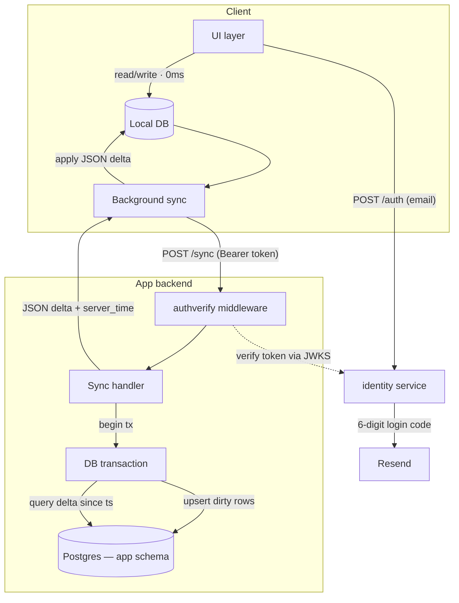
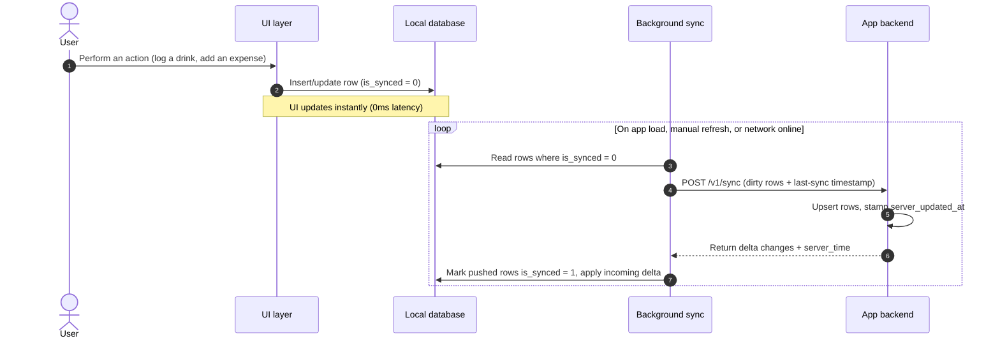

# Local-first application

Every Ducktivity app shares one skeleton. That skeleton is **local-first** — each app owns a local database, serves
every read and write from it, and syncs to the server in the background.



## The client store

The client owns a local database and serves all UI reads from it, so interactions are
instant and the app works offline. The server is the durable archive of all history.

| Platform                          | Store     | Library  | Sync engine runs in |
| --------------------------------- | --------- | -------- | ------------------- |
| **Web, Desktop** (SolidJS, Tauri) | IndexedDB | Dexie.js | Web Worker          |
| **Mobile** (Flutter)              | SQLite    | Drift    | Background isolate  |

## The backend

Each app backend is a stateless REST API written in Go. The `sync` endpoint's job:

1. **Authenticate** the Bearer token against identity service, which yields the caller's
   user id.
2. **Upsert dirty rows** the client pushed, inside one transaction, stamping each with a
   server-owned `server_updated_at`.
3. **Return the delta** the client is missing since its last-sync timestamp, plus the new
   server time, which the client stores as the cursor for its next sync.

## The sync model

The client's sync engine doesn't record every change as an event. Instead, each local row carries an `is_synced` flag, and the engine simply pushes the current state of any row still marked unsynced.



### Conflict resolution

Conflicts resolve by server-authoritative Last-Write-Wins:

- Rows are per-user and keyed by client-generated UUIDs, so logging the same kind of thing on two devices produces two distinct rows.
- When the same row is edited or deleted on more than one device, the backend's `server_updated_at` is the tiebreaker: the last write to reach the server wins.

Deletes are soft: the row is marked `is_deleted = true` instead of being removed, so other devices pick up the deletion of the same row on their next sync.

### The shared row spine

Every domain table across every app starts from the same columns, which is what lets the
sync engine stay generic:

```sql
id                uuid primary key,                      -- client-generated
user_id           uuid not null,                         -- soft ref to identity.users.id
occurred_at       timestamptz not null,                  -- domain event time
server_updated_at timestamptz not null default now(),    -- LWW tiebreaker
is_deleted        boolean not null default false
-- + the app's typed domain columns (amount_ml, category, …)
```
