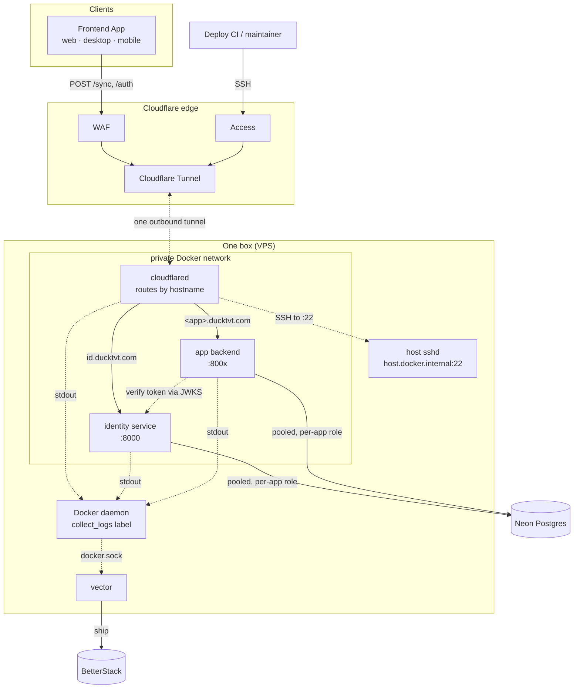

# Overview

The Ducktivity suite has three layers:

- **Clients** — frontend apps that read and write locally, then sync in the
  background.
- **Cloudflare edge** — acts as a secure bridge to expose internal services without opening the box's inbound ports.
- **Servers** — backend servers hosted on the same box (VPS) with a shared Postgres database.

## How it works

1. A frontend app sends `POST /sync` to Cloudflare's WAF.
2. The request travels through the outbound tunnel to `cloudflared` on the box, which routes by hostname (e.g., `id.ducktvt.com` → `http://identity-backend:8000`).
3. App backends verify user tokens with identity service's JWKS public key.
4. App backends query the shared Postgres database, each using its own role and schema.
5. Logs from every container flow to `vector`, which ships them to BetterStack.

The box opens no inbound ports, you can't reach the origin IP directly. Every request must pass through Cloudflare's firewall first. Even SSH goes through Cloudflare Access over the same tunnel, so port 22 stays closed.
