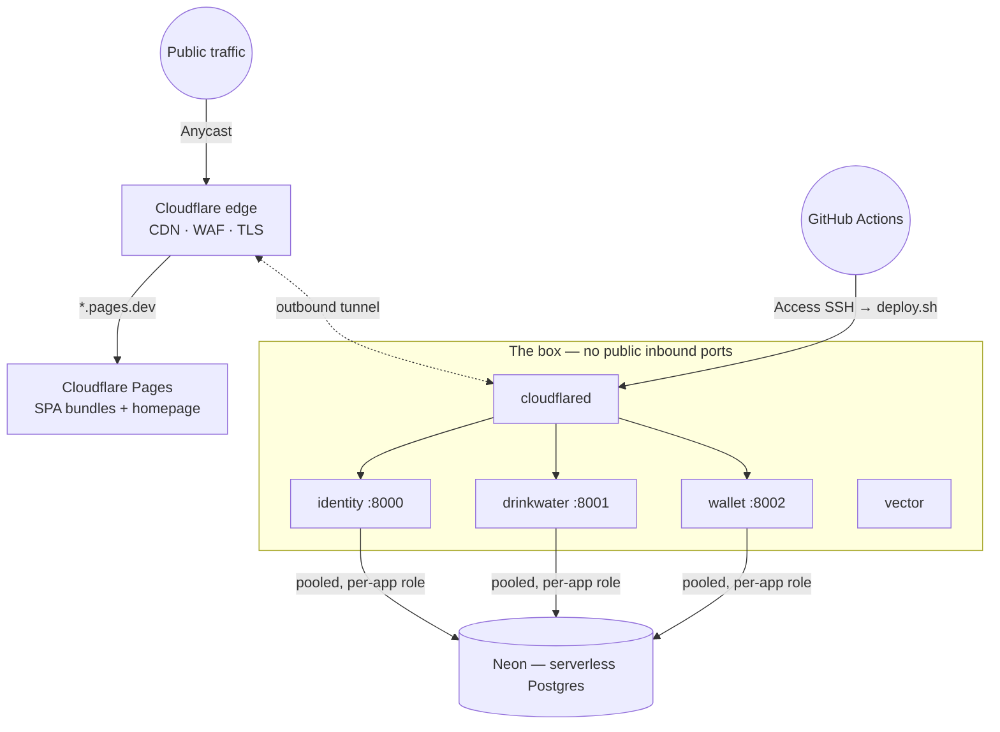

# Overview

The whole suite runs on **one small server** behind the Cloudflare edge, with durable
state in managed Postgres and static bundles on a free CDN. It is cheap, disposable, and
invisible to the public internet.



## The moving parts

- **The box.** A small server runs the platform plus one container per app on a shared
  Docker network. Each backend is a stateless Go process, so a modest instance carries the
  whole suite. It holds no durable data — it can be destroyed and rebuilt at will.
- **The database.** Neon (serverless Postgres) is the durable archive. It scales to zero,
  provides managed backups/PITR/failover, and backends use its **pooled** endpoint in the
  **same region** as the box.
- **The edge.** One Cloudflare account: static bundles from **Pages** (free, off-tunnel),
  dynamic backends through **one tunnel**.
- **The pipeline.** Push to `main` and GitHub Actions does the rest. See
  [the CI/CD pipeline](/deployment/pipeline).

## The shared edge

The **edge stack** (`edge` repo) is the box's boundary layer — the shared services between
the outside world and the app containers. Nothing app-specific lives here; every app plugs
into it.

| Piece                       | Role                                                                                             |
| --------------------------- | ------------------------------------------------------------------------------------------------ |
| `cloudflared`               | **Ingress.** The one Cloudflare tunnel connector for the whole suite. Also brokers admin/CI SSH. |
| `vector`                    | **Egress.** The one log shipper for the box; ships every app's logs to BetterStack.              |
| `ducktivity_edge` (network) | Where the apps meet these two services.                                                          |

`cloudflared` dials **out** to Cloudflare and holds the tunnel open, so **the box opens no
inbound ports**. A public request for e.g. `id.ducktvt.com` hits Cloudflare's edge,
travels down the tunnel, and `cloudflared` forwards it over `ducktivity_edge` to that app's
container (`identity-backend:8000`).

:::note
The hostname → container mapping lives in the **Cloudflare dashboard** (the tunnel's
**Public Hostnames**), not in a repo config file. Adding an app is: add one Public Hostname
rule + attach the app to the network. No new tunnel, no new connector token, ever.
:::

### Hostname plan

| Hostname                 | Served by                | Via                                        |
| ------------------------ | ------------------------ | ------------------------------------------ |
| `ducktvt.com`            | Homepage (static)        | Cloudflare Pages (off-tunnel)              |
| `drinkwater.ducktvt.com` | Drinkwater SPA + backend | Pages + tunnel → `drinkwater-backend:8001` |
| `id.ducktvt.com`         | identity backend         | tunnel → `identity-backend:8000`           |
| `api.wallet.ducktvt.com` | wallet backend           | tunnel → `wallet-backend:8002`             |

Each app is a distinct container **alias** on the shared network; the tunnel routes by
hostname, not by a public port.

### How an app plugs in

An app never runs its own `cloudflared` or `vector`. Its `deploy/docker-compose.yml` just
attaches to the shared network and labels itself for log collection:

```yaml
services:
  app:
    networks:
      ducktivity_edge:
        aliases: [drinkwater-backend] # unique per app
    labels:
      collect_logs: 'true' # vector ships its logs

networks:
  ducktivity_edge:
    external: true # created by the edge stack
```

The edge must be **up before any app**, because it creates the `ducktivity_edge` network.
It lives at `/opt/ducktivity/edge` on the box; deploy it with `./deploy/remote-deploy.sh`
or drive it directly with `docker compose up -d`.

## Security posture

The design's core property: **nothing connects to the origin server directly** — every
inbound byte passes through the Cloudflare edge first.

- **Zero public attack surface.** The box's firewall denies all inbound traffic; the only
  path in is the outbound tunnel `cloudflared` itself dials. A leaked origin IP is
  irrelevant — nothing answers on the raw IP.
- **Unbypassable edge controls.** Because the tunnel is the only way in, Cloudflare's WAF,
  rate limiting, and DDoS absorption can't be bypassed by hitting the origin.
- **Third-party callers flow through the edge.** Stripe webhooks reach identity via the
  Cloudflare hostname → tunnel; the webhook still verifies its own `Stripe-Signature`.
- **Outbound is unrestricted.** The box dials its own outbound connections — Neon, the
  tunnel, log shipping — unaffected by the closed inbound firewall.
- **Private admin access.** SSH is not exposed publicly. Administrative and CI access is
  brokered through **Cloudflare Access** over the same edge, so port 22 stays closed. See
  [the pipeline](/deployment/pipeline#the-two-authentication-factors).

## Web & desktop distribution

SPAs never go through the tunnel — they're static files served free from **Cloudflare
Pages** at edge speed, so the box spends zero CPU on HTML/JS.

- **Web (Drinkwater SPA)** deploys to Cloudflare Pages on push to `main`.
- **Desktop (Drinkwater)** ships as a **GitHub Release**: the Tauri Windows installer plus
  signed update artifacts, published by a version-gated workflow. Installed copies update
  themselves via the Tauri auto-updater. See
  [desktop releases](/deployment/pipeline#desktop-releases).
