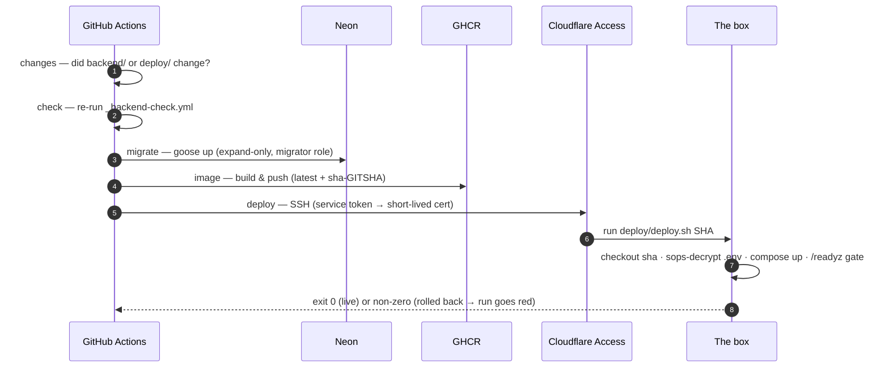

# CI/CD pipeline

Deploy is **push-based and synchronous**. Merge to `main` and one GitHub Actions run does
everything — there is no separate deploy step and no deploy-health alert to build: a failed
deploy simply turns the Actions run **red**.

Each repo owns its own pipeline, but they follow the same pattern: **reusable check
workflows** (the single source of truth for "this component is sound") called by both
PR-time CI and CD.

## Pull requests — verify only

Every PR into `main` runs the reusable checks; branch protection requires them to pass.
**PRs ship nothing** — no image, no Pages deploy, no installer.

| Reusable gate | Checks |
| --- | --- |
| `_backend-check.yml` | `gofmt`, `go vet`, `go build`, `go test`, staticcheck, gosec |
| `_web-check.yml` | `pnpm typecheck`, `pnpm lint`, `pnpm build` |
| `_desktop-check.yml` | `cargo fmt --check`, `cargo clippy -D warnings` (Rust shell only) |

Drinkwater's `ci-prod.yml` fans out to all three; a backend-only app like Wallet runs just
`_backend-check.yml`.

## Push to main — Backend CD

On a push to `main` that touches `backend/` or `deploy/`, **Backend CD** (`cd-backend.yml`)
runs the full pipeline on the exact commit:



- **changes** — diffs against the prior commit. If neither `backend/` nor `deploy/`
  changed, every job below is skipped and the run stays green.
- **check** — re-runs the same `_backend-check.yml` gate the PR ran, guarding against drift
  before anything is published.
- **migrate** — applies the expand-only goose migration **straight at Neon**, using the
  higher-privilege `DATABASE_URL_MIGRATOR` role. Runs **before** the image is published, so
  schema and old container stay compatible during the brief cutover.
- **image** — builds the distroless image and pushes it to GHCR under an immutable
  `sha-<gitsha>` tag plus a moving `latest`. The git sha is baked in via `-ldflags`, so the
  running binary and its logs report the exact commit.
- **deploy** — installs `cloudflared`, opens an Access SSH tunnel with a service token, and
  runs `deploy/deploy.sh <full-sha>` on the box. CI watches the exit code synchronously, so
  a failed deploy fails **this** job.

:::note
A **`deploy/`-only change** runs the *same* full pipeline, so that commit still gets its own
`sha-<gitsha>` image for `deploy.sh` to pin — backend layers are cached, so the rebuild is
near-instant.
:::

## What `deploy.sh <sha>` does on the box

The deploy that CI triggers is a single script that runs **on the box**, invoked over
Cloudflare Access SSH with the exact git sha:

1. **Pin the image from the sha argument**, not from anything in the tree — so a git sync
   can never make Docker deploy the wrong build. The tag is `sha-<first 7 hex>`, matching
   CI's image metadata.
2. **Sync the box's clone to that exact commit** with cone-mode sparse-checkout of
   `deploy/` only (the backend source lives in the prebuilt image). On a rollback the sha
   is deliberately an older commit, so you get *that* commit's `deploy/` tree.
3. **Decrypt secrets** — `sops --decrypt .env.sops → .env` with an atomic swap, so a failed
   decrypt leaves the last good `.env` intact.
4. **Converge** — `docker compose pull` + `up -d` at the pinned tag, after recording the
   currently-live tag as the rollback target.
5. **Gate on `/readyz`** — probe up to ~30s from a throwaway curl container on the shared
   edge network (the app image is distroless, no curl inside). If it never becomes ready,
   **roll back** to `.last_good_tag` and **exit non-zero**, which turns the CI run red.

:::note
`docker compose up` recreates the container with a brief (~1s) gap, accepted at current
traffic. Expand-only migrations keep the old and new containers valid against the same
schema during the overlap.
:::

## Secrets — SOPS-encrypted in the repo

Box secrets live **committed** as `deploy/.env.sops` — **values encrypted, keys readable** —
with the SOPS config in `deploy/.sops.yaml`. The plaintext `.env.prod` never leaves your
disk; the box decrypts on the fly with its **age key**.

```bash
./deploy/secrets.sh edit       # open decrypted secrets in $EDITOR, re-encrypt on save
./deploy/secrets.sh encrypt    # (re)create .env.sops from local .env.prod
./deploy/secrets.sh view       # print decrypted secrets to stdout
```

Edit, commit `.env.sops`, push — the new secrets apply on the next deploy. Only the service
that needs a secret holds it: identity holds the signing key and Resend/Stripe secrets;
each app holds only its own `DATABASE_URL`, `JWKS_URL`, and `AUTH_ISSUER`.

## The two authentication factors

The deploy path is gated by **two independent factors**, so neither alone reaches the box:

- **Cloudflare Access.** A **service token** authenticates the Access application in front
  of the SSH hostname and mints a short-lived certificate. No standing key opens the tunnel,
  and port 22 is never public.
- **Forced-command SSH key.** The box's `authorized_keys` forces every login through
  `deploy/ssh-forced-command.sh`, which parses the 40-hex sha out of the command and execs
  `deploy.sh` with it. The key can do nothing *but* deploy.

## Rollback

Rollback is an **image revert only — never a down migration.** Because every release's
migration is additive, the previous backend runs correctly against the current schema. Roll
back to any past commit from your machine:

```bash
./deploy/remote-deploy.sh <full-git-sha>
```

This runs the same `deploy.sh` on the box, pinned to the older sha, and re-gates on
`/readyz`.

## Desktop releases

Drinkwater's **Desktop Release** (`cd-desktop.yml`) is **version-gated** and fires on the
same push to `main` (or a manual `v*` tag):

- A `decide` job reads the desktop version from `web-desktop/package.json`. If that version
  has no `vX.Y.Z` tag yet, it publishes; if already released, every job is skipped and the
  run finishes green.
- On release, it verifies the web + desktop checks, builds and **signs** the Tauri Windows
  installer, generates release notes from Conventional Commits with **git-cliff**, and
  publishes a **GitHub Release** (installer + `latest.json`), auto-creating the tag.
- Installed copies update themselves: the Tauri auto-updater reads `latest.json` from the
  latest Release.

Bump the version with `pnpm run release <version>`, commit, merge — the release publishes
itself.

## Web releases

The SolidJS SPA is served from **Cloudflare Pages** (off-tunnel, free edge) and deploys on
push to `main`. Because the API is expand-only, a freshly-deployed backend stays compatible
with a still-cached local-first client; the new bundle takes effect on the next client load.

## One-time setup

Setting up a repo's deploy the first time (summarized from each `deploy/README.md`):

1. **Your machine.** Install `sops` + `age`. Generate an operator age key. For manual
   `remote-deploy.sh`, also install `cloudflared` and source an Access service token
   (`TUNNEL_SERVICE_TOKEN_ID` / `TUNNEL_SERVICE_TOKEN_SECRET`).
2. **The box.** Pin Docker's DNS to public resolvers in `/etc/docker/daemon.json`
   (`{"dns":["1.1.1.1","8.8.8.8"]}`). Install `sops` + `age` and place the box age key at
   `/etc/ducktivity/age-key.txt` (owned by `deploy`, mode `600`).
3. **Deploy SSH key.** Create a CI keypair; add the **public** half to the box's
   `authorized_keys` forced to `deploy/ssh-forced-command.sh`; put the **private** half in
   the GitHub `DEPLOY_SSH_KEY` secret.
4. **First secrets.** `cp deploy/.env.example deploy/.env.prod`, fill it,
   `./deploy/secrets.sh encrypt`, commit `deploy/.env.sops`, push.
5. **CI secrets/vars.** Set `DATABASE_URL_MIGRATOR`, `TUNNEL_SERVICE_TOKEN_ID/SECRET`,
   `DEPLOY_SSH_KEY`, and the `DEPLOY_SSH_HOSTNAME` var. Restrict the `production`
   environment to `main`.

Each app repo clones to `/opt/ducktivity/<app>` on the box; the edge stack lives at
`/opt/ducktivity/edge` and must be up first so its `ducktivity_edge` network exists.
