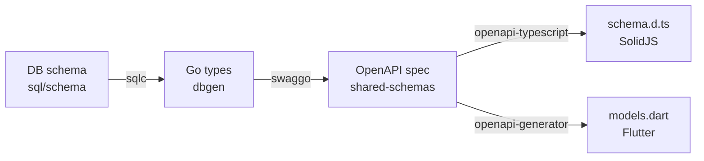

# Schema & codegen

Every data model change starts in one place — the database schema — and flows outward
through code generation. Nothing downstream is hand-written: you regenerate and commit the
output so it always matches its source.

## The rules

1. **Model changes start in `sql/schema`.** A new column or table is a new **goose
   migration** in `backend/sql/schema` — expand-only.
2. **Queries live in `sql/queries`, compiled by sqlc.** Never write raw SQL strings in
   handlers. Put queries in `backend/sql/queries` and generate typed Go into `dbgen/`.
3. **The API contract is generated by swaggo.** Annotate handlers with swaggo comments;
   export the OpenAPI spec into `shared-schemas/`.
4. **Client types are generated from OpenAPI.** SolidJS types come from
   `openapi-typescript`; Flutter models from `openapi-generator`. Never hand-write API
   types.
